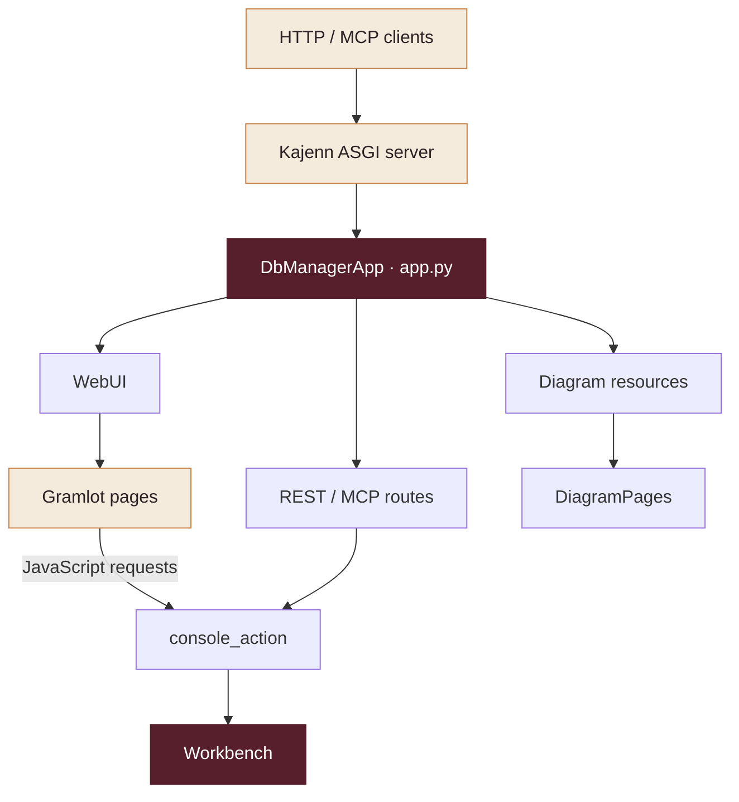
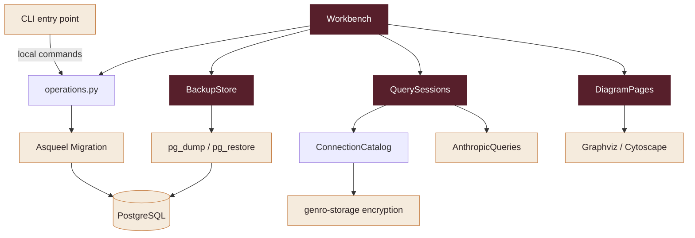
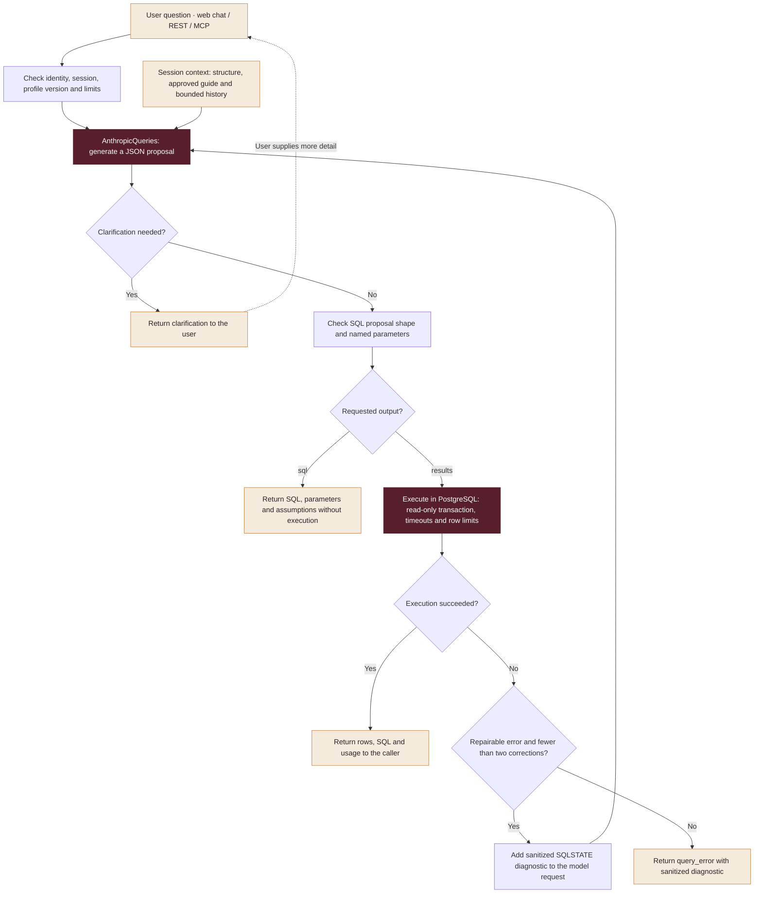

# Code guide: architecture, classes and execution flows

This guide describes how DB Manager 0.2.0 is implemented. Start here when reading
the repository or adding functionality; use the [API reference](api.md) for request
contracts and the [workbench guide](workbench.md) for operating instructions.
Source modules live under [`src/asqueel_dbmanager/`](https://github.com/asqueel-org/asqueel-dbmanager/tree/v0.2.0/src/asqueel_dbmanager).
The matching [tests](https://github.com/asqueel-org/asqueel-dbmanager/tree/v0.2.0/tests) document the behavioral contracts.

## Architectural approach

DB Manager is a Python application composed into Kajenn, not a separate web
framework or SQL migration engine. Kajenn supplies the ASGI server, routing,
OpenAPI and MCP transport. Asqueel Migration supplies database introspection,
structure validation, migration planning and application. DB Manager coordinates
these capabilities, adds profiles and workflows, and exposes them to clients.

The browser workbench is another client of those services. Gramlot builds its
HTML pages; JavaScript calls the same `console_action` service available through
REST/MCP. There is no independent browser-only implementation of migrations,
backup or query execution.

The first diagram shows the entry points and request dispatch:

The second diagram expands the services used by the workbench and local CLI
commands. Workbench accesses app-owned services through `DbManagerApp`:

These diagrams are dependency maps. The application, workbench, catalog and
session manager run inside the same server process. PostgreSQL, Graphviz,
1Password and the model provider are external integrations; Cytoscape runs in
the browser. `BackupStore` invokes PostgreSQL's `pg_dump` / `pg_restore` under
the shared DB lock. `ConnectionCatalog` uses genro-storage encryption for
profiles and guide metadata.

## Main classes and responsibilities

| Class | Module | Responsibility and lifetime |
| --- | --- | --- |
| `DbManagerApp` | `app.py` | Kajenn `McpOpenApiApplication`; request boundary, decorated operations, lazy services and shutdown |
| `Workbench` | `workbench.py` | Profile-based workflow dispatcher owned by one app; coordinates guides, diagrams, maintenance and chat |
| `WebUI` | `web_ui.py` | ASGI bridge to Gramlot core; created on the first UI request and closed with the app |
| `ShellPage` | `ui_pages.py` | Gramlot page for navigation and persistent iframe workspaces |
| `PageBase` | `ui_pages.py` | Shared Gramlot page layout and native HTML forms |
| `Page` subclasses | `pages/*.py` | Select a workspace's kind and title; `home.py` supplies the detailed English instructions |
| `Logic` | `pages/workbench.js` | Browser-side event wiring, API calls, form state and result rendering |
| `ConnectionCatalog` | `query_profiles.py` | Encrypted named connections, identity allowlists and encrypted workbench metadata |
| `QuerySession` | `query_sessions.py` | Dataclass holding one conversation's owner, structure, prefix, expiry, history and lock |
| `QuerySessions` | `query_sessions.py` | In-memory session registry, model calls, SQL repair and prompt-cache maintenance |
| `AnthropicQueries` | `query_provider.py` | Anthropic HTTP transport, response parsing and token/cache metrics |
| `BackupStore` | `backups.py` | Logical PostgreSQL archives, metadata, checksums, verification and restore |
| `DiagramPages` | `diagram_pages.py` | Persistent SVG or Cytoscape snapshots, generated IDs and snapshot lookup |
| `DbManagerWorker` | `app.py` | Legacy Kajenn task execution; retained separately from the new workbench scope |

Supporting exceptions carry controlled public messages: `QueryError` for profile
and query workflows, `ReadQueryError` for sanitized SQL diagnostics,
`DiagramRenderError` for renderer failures, `GenropyConnectionError` for instance
resolution and `DatabaseBusy` for advisory-lock contention.

## Entry points and request handling

`__main__.py:main()` parses CLI commands. Local introspection, backup and diagram
commands call Python services directly. Diagram publication uses the configured
HTTP server. Without a subcommand, the CLI starts `AsgiServer` with
`DbManagerApp` and the legacy `DbManagerWorker`, bound to localhost. `--ui` checks
that Gramlot is installed and prints the workbench URL.

`DbManagerApp` can also be imported and mounted in another Kajenn server; importing
it does not start a listener. The mount determines prefixes for API routes, UI
assets and diagram URLs. See [installation](installation.md).

For HTTP requests, `DbManagerApp.__call__()` checks local/Kajenn access mode,
identity, administrator tags, Host and browser origin. It dispatches `/ui` to
`WebUI`, `/diagrams` to snapshot handling, and other requests to Kajenn routing.
Identity and administrator status are propagated with `ContextVar` values and
reset after the request. Methods decorated with `@route` supply the REST/MCP
contracts. `_call()` maps service exceptions to controlled HTTP errors.

The app owns a `Workbench`; it lazily creates `QuerySessions` under a lock and
`WebUI` when needed. Shutdown closes Gramlot pages, stops query-cache maintenance,
clears sessions and invokes the superclass lifecycle hook. Sessions are not a
distributed store: use the documented single-process deployment model.

## Database operations and maintenance

`operations.py` deliberately uses functions rather than a stateful repository:

- `connection_params()` accepts an explicit set of PostgreSQL connection options.
- `database()` creates a request-scoped `PgDatabase` and closes it in `finally`.
- `normalize()` converts supported input into validated Migration JSON.
- `introspect()` discovers accessible non-system schemas when none are supplied,
  then delegates structure reading to Migration.
- `plan()` delegates comparison and SQL planning to `plan_migration()`.
- `apply()` acquires the database lock and delegates to `apply_migration()` with
  the caller's reviewed plan identifier.

`database_lock()` takes a PostgreSQL advisory lock keyed by database name in the
maintenance database. Apply, backup and restore share this mechanism across DB
Manager processes. External DDL tools must cooperate; it is not a general DDL lock.

`BackupStore.create()` writes a custom-format dump, checks it with `pg_restore
--list`, and records its checksum and metadata. `verify()` checks the archive.
`restore()` requires confirmation and an existing empty destination, and performs
the restore under the same lock. Executable calls use argument lists; passwords
are supplied through the child environment, and raw command diagnostics are not
returned to clients. See [backup limits](backups.md).

`Workbench.call()` adds logical-profile selection and confirmations to these
operations. Its `RLock` coordinates metadata updates inside one process. Backup
IDs recorded in a source profile's encrypted metadata determine which archives
the workbench exposes for that profile.

## Profiles, guides and privacy data

`ConnectionCatalog.save()` writes one encrypted document per profile. It validates
names, restricts file/directory permissions and publishes a temporary file
atomically. `load()` checks the identity allowlist, decrypts the connection and
returns a ciphertext fingerprint used as the profile version. It never provides
a public plaintext connection-export endpoint.

The key comes from the configured environment or an explicit 1Password reference.
`read_secret()` invokes `op read` and suppresses its raw diagnostics. Encryption
is delegated to `genro_storage.StorageManager`, not implemented in this project.

Workbench metadata is kept in a separate encrypted `.console_NAME.json` file.
It contains registration provenance, attributed backup IDs and a database guide.
The guide records descriptions, physical structure, privacy choices, revision,
status, timestamps and profile/structure fingerprints. `prepare` produces a draft;
`save_guide` checks the submitted revision before saving or confirming enrollment.

Table defaults and column overrides preserve the difference between inherited
privacy, `H` and explicit `null`. They are persisted for future result encoding.
In this version, no query result rows are sent to the model. Approved descriptions
are model context, so privacy settings are not a reason to place confidential
values in those descriptions. These flags are also not database access grants.

## Natural-language query flow

The diagram follows one question in an open query session. Session setup loads
the authorized database structure and approved guide descriptions, then warms
the model's prompt cache. The same question flow serves web chat, REST and MCP.

Database result rows go directly to the caller; they are not sent to the model
for a final rewrite. Repair requests contain sanitized diagnostics, never raw
database error messages. Invalid requests, expired sessions and invalid model
responses stop with an error; they do not enter the SQL repair loop.

1. `QuerySessions.open()` loads an authorized profile, introspects its structure
   and builds compact table/column/relation metadata with `structure_details()`.
2. If a ready guide exists, its profile and structure fingerprints must match.
   Approved descriptions are added to the model prefix. Web chat additionally
   requires confirmed enrollment through `Workbench`.
3. The manager warms the provider cache and creates a `QuerySession`. The stable
   prefix excludes session IDs and current timestamps. A thread maintains cached
   prefixes only while sessions remain open and unexpired.
4. `ask()` checks identity, profile version, limits and session state, then calls
   the provider with the frozen prefix, bounded conversation history and question.
5. `AnthropicQueries.call()` returns a JSON proposal: SQL, named parameters,
   assumptions or a clarification, plus usage metrics. It uses a one-hour cache
   TTL; `QuerySessions` schedules refreshes and handles uncached prefixes.
6. `output="sql"` returns the proposal without execution or PostgreSQL validation.
   `output="results"` passes it to `execute_read()`.
7. A repairable PostgreSQL failure can trigger at most two corrections. Only
   sanitized SQLSTATE-based diagnostics and optional statement position go back
   to the provider. Results and raw database error messages do not enter history.

`prepare_sql()` checks response shape and parameters; it is not a SQL parser.
`execute_read()` uses a fresh read-only transaction, timeouts, a restricted search
path, one prepared statement, a subquery wrapper and bounded rows/response size.
PostgreSQL validates the SQL. Read-only mode is not a function sandbox: database
role privileges remain the authorization boundary.

Session state is held in memory and disappears on restart. Per-session locks
serialize conversation operations; the registry has a separate lock. Capacity,
expiry and profile-version checks bound use. `close()` invalidates a session and
`shutdown()` stops the manager. See [query sessions](queries.md) for exact limits.

## Diagram pipeline

`diagrams.py` validates Migration JSON, selects schemas/tables or a related
cluster, and emits DOT. `_render_svg()` invokes Graphviz's `dot` with a timeout;
plain DOT output does not require Graphviz.

For interaction, `cytoscape_view.graph_data()` converts the same selected structure
into nodes and foreign-key edges. `DiagramPages.create()` stores the graph rather
than browser markup. When the viewer is served, `interactive_viewer()` computes
card sizes and optional initial Graphviz positions, then fills the packaged HTML
template. `graphviz_layout.py` converts Graphviz coordinates to browser positions;
if the optional executable is unavailable, browser layouts remain usable.

`static/cytoscape-view.js` manages filters, layout choice, pan/zoom, draggable
tables, column scrolling and PNG export. HTML table overlays follow Cytoscape node
positions and have a bounded visible column area. Positions can be saved in local
browser storage for that snapshot. The packaged Cytoscape library includes its
MIT license notice.

Workbench snapshots also store a profile name/version binding. HTML and download
requests recheck profile access and invalidate snapshots after profile replacement.
Authorized workbench viewers allow same-origin embedding. Legacy raw-structure
snapshots have the separately documented administrator boundary.

## Gramlot pages and browser logic

`WebUI` hosts `gramlot.server.GramlotFileServer`. It serves bootstrap/runtime
assets, dispatches the Source protocol and restricts page/asset names to an
allowlist. A private cookie and Kajenn identity jointly own a Gramlot page.
The standard Gramlot Kajenn adapter is not used because its required Kajenn
version differs from this application's pinned range; the bridge is isolated
so it can be replaced during a deliberate framework upgrade.

`ShellPage.main()` builds navigation and the initial Getting started iframe.
`PageBase` defines shared layout and forms. Small files such as `pages/chat.py`
set the page kind/title; `pages/home.py` adds operating instructions. These are
real Gramlot page definitions using native HTML elements, not the POC's advanced
component library.

Each page exports the shared JavaScript `Logic` class. `start()` mounts listeners
once, calls `console_action`, updates forms and renders output using text nodes.
The shell retains iframe workspaces when switching pages. The home page performs
no catalog or model requests. Diagram controls and canvas behavior live in their
separate static viewer, while `workbench.js` handles profile selection and index
details. `workbench.css` controls responsive navigation and workspace sizing.

## Persistence and ownership map

| State | Storage | Owner/lifetime |
| --- | --- | --- |
| Connections and workbench guides | Encrypted profile catalog | Server filesystem; checked against profile identities |
| Query sessions and conversation history | Process memory | Session owner; expires or closes |
| Provider prompt cache | Model provider | Provider TTL; maintenance limited to active sessions |
| Diagram snapshots | Private JSON files | Server filesystem; profile-bound reads reauthorized |
| User-adjusted diagram positions | Browser local storage | Browser and snapshot ID |
| Backup archives and checksums | Backup directory | Server filesystem; workbench attribution in profile metadata |
| Legacy task state | Kajenn spool | Existing task executor; outside the new workbench flow |

Database result rows are returned to the authorized caller. They are not an input
to the current provider transport. Backup archives and diagram snapshots are not
encrypted by `ConnectionCatalog`; protect their server directories appropriately.

## Extending the application

- **New operation:** put reusable logic in a service module. Expose it with a typed
  `DbManagerApp` route or a `Workbench.call()` action. Define identity checks,
  administrator requirements, confirmations and controlled error messages there.
- **New workspace:** add a `PageBase` subclass and JavaScript module, register its
  navigation entry and `WebUI` allowlists, and add its service/action handling.
  Keep business logic out of page definitions.
- **New provider:** supply an object with `model` and `call(prefix, messages=None)`
  to `QuerySessions`. Preserve proposal, usage and warmup contracts. Tests inject
  fake providers rather than spending tokens or transmitting database content.
- **New database backend:** extend the Migration integration and connection/query/
  backup contracts deliberately. Swapping a driver alone does not remove the
  PostgreSQL-specific SQL, locking, archive and read-query behavior.
- **New renderer:** adapt normalized structure and preserve filter semantics,
  asset packaging, escaping and snapshot authorization. Keep optional executables
  separate from authorization capabilities.

## Tests and recommended reading order

Read `app.py`, then `workbench.py` and `operations.py`. Follow the relevant branch
into profiles/queries, backups or diagrams. Read `web_ui.py`, `ui_pages.py` and
`pages/workbench.js` together to understand the browser integration.

`tests/conftest.py` drives HTTP requests through the real ASGI stack.
`test_app.py` and `test_mounting.py` cover routing and boundaries;
`test_workbench.py` covers workflows and Gramlot rendering. `test_queries.py`
uses injected clocks/providers to exercise sessions without a live model.
`test_postgresql.py` validates actual PostgreSQL operations and read-query behavior
using isolated test databases. Diagram and Genropy tests cover conversion,
filters, rendering, configuration resolution and error handling.

CI runs Python 3.11–3.13 with PostgreSQL and Graphviz, builds distributions and
reruns tests after installing the wheel. Sphinx builds with warnings as errors.
See [development](development.md) for commands and the release workflow.
