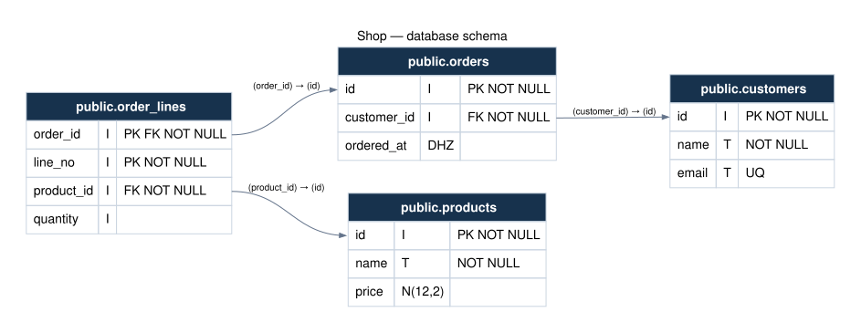

# Schema diagrams

> **Source beta:** these features are available on the public GitHub branch.
> Install from source for UI, diagrams, Genropy CLI and AI queries; the PyPI
> package has not been updated yet. See [availability](availability.md).

Generate a diagram directly from **normalized Asqueel Migration JSON**, such as
the result of `introspect` or `JsonStructureProducer(...).get_json_struct()`.
The manager validates the structure with Migration and translates it to
[Graphviz](https://graphviz.org/) DOT. Graphviz handles layout and SVG rendering.
Rendering JSON requires no database connection or external rendering service.
The CLI can also read a Genropy instance's live database before rendering.



Download the [example JSON](../_static/diagram-example.json) and
[SVG diagram](../_static/diagram-example.svg).

## Command line

Install the manager, then install Graphviz for SVG output:

```bash
# macOS
brew install graphviz
# Debian / Ubuntu
sudo apt-get install graphviz
```

The `dot` executable must be on `PATH`. No additional Python rendering package
is needed. Generate a standalone image or an editable DOT source:

```bash
asqueel-dbmanager diagram schema.json -o schema.svg
asqueel-dbmanager diagram schema.json --format dot -o schema.dot
asqueel-dbmanager diagram schema.json --direction TB -o vertical.svg
```

`--format` defaults to `svg`; it is not inferred from the output filename.
`--direction LR` (default) lays out left to right; `TB` lays out top to bottom.
`-` reads stdin or writes stdout; output defaults to stdout:

```bash
cat schema.json | asqueel-dbmanager diagram - --format dot > schema.dot
```

Input and output files use UTF-8. `-o` refuses to overwrite an existing file.
Invalid input, file errors or renderer failures return exit status 2, with a
message on stderr. The existing server command remains unchanged:
`asqueel-dbmanager --port 8000`. `python -m asqueel_dbmanager` accepts the same
arguments when using a source checkout.

### From a Genropy instance

Use `-g` (or `--genropy`) instead of a JSON input file:

```bash
asqueel-dbmanager diagram -g test_invoice_pg -o test_invoice_pg.svg
asqueel-dbmanager diagram --genropy test_invoice_pg --format dot -o test_invoice_pg.dot
```

The same instance selector works with the `introspect` and `backup` commands;
see the [CLI guide](cli.md).

Install `asqueel-dbmanager[postgresql]` in the Python environment where Genropy
and its dependencies are available. Genropy's configuration must resolve the
instance name. SVG additionally requires Graphviz on `PATH`.

The command uses Genropy's `PathResolver.get_instanceconfig()` to read the
merged instance configuration, including defaults/templates, and passes the
connection parameters to Asqueel Migration. Migration reads the **actual
database structure**; the resulting JSON is rendered into DOT or SVG. This
does not start `GnrApp`, load application packages or apply migrations.

Connection settings stay in memory and are not saved in DB Manager or included
in the diagram. Environment references (`$VARIABLE` and `{VARIABLE}`) are
resolved, and `GNR_DB_DSN` overrides the connection when set. This override
accepts a PostgreSQL URL without query parameters or fragments. Missing
variables and connection failures produce a diagnostic without credential
values. No structure cache is used: each invocation reads the database again.

This first integration supports the primary PostgreSQL database only
(`postgres`, `postgres3`, `postgresql`). Remote/store selectors and automatic
SSH tunnels are unsupported. Instance-name resolution is local to the CLI;
REST/MCP continue to accept explicit connection parameters via `introspect`
and its returned structure via `diagram`.

## REST and MCP

### Filter schemas, tables and related clusters

The Python function, REST/MCP operations `diagram` and `publish_diagram`, and
the CLI accept the same diagram filters. Filtering happens **after** validation
of the complete input, without changing the database or the original JSON:

```bash
asqueel-dbmanager diagram -g test_invoice_pg --schema invc -o invoices.svg
asqueel-dbmanager diagram -g test_invoice_pg --table invc.invc_invoice --table invc.invc_invoice_row -o selected.svg
asqueel-dbmanager diagram -g test_invoice_pg --cluster invc.invc_invoice --depth 1 -o cluster.svg
asqueel-dbmanager diagram -g test_invoice_pg --cluster invc.invc_invoice --relatives ancestors -o ancestors.svg
```

For an HTML URL, replace `-o FILE` with
`--server-url http://127.0.0.1:8000/dbmanager`. These options also work with JSON
files and stdin. The CLI reads the full structure when using `-g`, so relations
across schema boundaries can be followed before the view is filtered.

| CLI option | REST/MCP/Python argument | Meaning |
| --- | --- | --- |
| `--schema NAME` (repeatable) | `schemas: list[str]` | Show tables in the selected schemas |
| `--table SCHEMA.TABLE` (repeatable) | `tables: list[str]` | Show exactly the selected tables |
| `--cluster SCHEMA.TABLE` | `cluster: str` | Start with this table and follow its foreign-key ancestry/descendants |
| `--relatives both/ancestors/descendants` | `relatives: str` | Cluster traversal direction; default `both` |
| `--depth N` | `depth: int` | Maximum FK hops in each direction; default unlimited, `0` shows only the starting table |

Ancestors are referenced tables (following outgoing foreign keys); descendants
are referencing tables (following incoming foreign keys). The two traversals
start independently at the selected table. They do not alternate directions:
the siblings of an ancestor and the other parents of a descendant are not
automatically included. Self references and cycles terminate safely; composite
foreign keys count as one hop. Only declared database foreign keys are used.

Schema, explicit-table and cluster filters intersect when combined. Cluster
traversal uses the complete input graph first; other filters then restrict what
is displayed. Names should be `schema.table`; an unqualified table name is
accepted only when unambiguous. Unknown or ambiguous names are errors.
`depth` and a non-default `relatives` require `cluster`. An explicit empty
`schemas` or `tables` list selects no tables; omitting them imposes no restriction.

Only edges with both endpoints visible are drawn. Columns still show `FK` when
the referenced table is hidden. Returned table/relation counts describe the
visible diagram. A published page is a fixed filtered snapshot: generating
another selection produces a new URL; existing pages remain unchanged.

### Publish a browser page

Use `POST /publish_diagram` or the MCP tool `publish_diagram` with `structure`,
optional `direction` (`LR` or `TB`) and optional `title`. The server renders SVG,
saves the snapshot and returns `diagram_id`, `tables`, `relations`, `url` and
`svg_url`. The URLs are relative to the server origin and include the app mount:

```json
{
  "diagram_id": "0123456789abcdef0123456789abcdef",
  "tables": 4,
  "relations": 3,
  "url": "/dbmanager/diagrams/0123456789abcdef0123456789abcdef",
  "svg_url": "/dbmanager/diagrams/0123456789abcdef0123456789abcdef.svg"
}
```

Open `url` on the same server to view an HTML page with zoom, fit-to-width and
SVG download. For example, with origin `http://127.0.0.1:8000`, prepend that
origin to the returned URL. Pages and downloads accept GET/HEAD and keep the
same localhost restriction as the API. Publishing requires Graphviz on the
server; viewing a saved page requires neither Graphviz nor database access.

From the CLI, publish to an already running server and print the full URL:

```bash
asqueel-dbmanager diagram -g test_invoice_pg --server-url http://127.0.0.1:8000/dbmanager
asqueel-dbmanager diagram structure.json --server-url http://127.0.0.1:8000/dbmanager
```

Use the application's base URL, including its mount if present. The CLI sends
only the structure and direction to `publish_diagram`; Genropy connection
settings remain local. `--server-url` cannot be combined with `-o` or DOT output.

Snapshots contain the rendered SVG and title, not connection credentials or a
database connection. They are stored in `ASQUEEL_DBMANAGER_DIAGRAM_DIR`, default
`.dbmanager/diagrams` relative to the server's working directory. They survive
server restarts when this directory is retained; use persistent shared storage
for multiple processes or containers. There is no automatic expiry or cleanup.
Delete the corresponding `<diagram_id>.json` file to remove a snapshot and
invalidate its URLs. Access to the directory should be limited like access to
other database structure exports. Regenerate the snapshot to reflect changes
to the database.

### Experimental Cytoscape viewer

The default Graphviz renderer, DOT/SVG exports and existing snapshot URLs remain
unchanged. Opt into an independent interactive viewer with:

```bash
asqueel-dbmanager diagram -g test_invoice_pg --cluster invc.invc_invoice --depth 1 --renderer cytoscape --server-url http://127.0.0.1:8000/dbmanager
```

REST/MCP callers pass `renderer="cytoscape"` to `publish_diagram`. Existing
`schemas`, `tables`, `cluster`, `relatives`, `depth` and `direction` parameters
are supported. The response contains `url` and `graph_url` (Cytoscape JSON)
instead of `svg_url`. Cytoscape renders the interactive view. When available,
Graphviz supplies its initial table positions; otherwise Cytoscape computes them.
Graphviz remains optional. Offline `diagram` DOT/SVG behavior is unchanged;
the CLI's experimental renderer requires `--server-url`.

- Drag table headers; foreign-key endpoints follow the associated columns.
  Composite keys connect at the table header with their ordered mapping available
  in relation details. Self references are supported. While scrolling, endpoints
  for offscreen columns stay at the nearest boundary of the column area.
- All columns are shown by default. Cards have a maximum height of **416 pixels**
  (15 visible column rows plus header and footer); scroll inside a card to
  inspect further columns. The header stays fixed and draggable. Background
  scrolling still controls diagram zoom. Column areas also support keyboard
  scrolling when focused. At overview zoom levels below 35%, use **Readable**
  or zoom in to enable scrolling within cards.
- **Keys only** filters rows, including referenced target columns, without
  changing card dimensions, positions or zoom. Layout always reserves the same
  footprint, measured from all columns, so switching back cannot create overlaps.
  Select a table to inspect all columns in the sidebar. Small screens use
  **Tables / details** to toggle this panel.
- The initial **Graphviz** layout uses native `dot`, accounting for card sizes
  and packing disconnected components. It is available only when layout succeeds
  on the server; missing Graphviz, failures or timeouts fall back to **Compact**
  (Cytoscape CoSE). **Hierarchy** and **Grid** remain available.
  Saved browser positions take precedence on opening.
- **Reset layout** applies the selected mode without overwriting saved positions.
  Graphviz restores precomputed snapshot coordinates for visible tables;
  it does not recompute a filtered subgraph.
  Relations are drawn by Cytoscape, so their paths differ from Graphviz SVG.
- Opening a graph uses a readable scale (at least 85%), centered on a connected
  table when the entire graph would be too small. **Fit** provides the full
  overview; **Readable** returns to a legible scale, prioritizing a selected
  table. The current zoom percentage is shown beside the controls. Large graphs
  therefore extend beyond the viewport: pan the background to explore them.
- Use **Fit**, zoom controls, or **Reset layout** to navigate. Select a table
  from the sidebar to center it without changing the zoom. **Download PNG** prepares the current diagram;
  **Save PNG** downloads the generated image. The PNG includes the current
  scrolled portion of each card, rather than expanding every column.
- Schema and cluster controls filter within the saved snapshot; they cannot
  recover tables excluded at publication. They use the same independent
  ancestor/descendant traversal and depth semantics as server filters.
- **Save positions** stores the arrangement in this browser for this snapshot.
  Reload restores it. Positions are not written to the database or shared with
  other browsers. Browser storage can be unavailable or cleared.

The snapshot stores a filtered graph of table/column metadata and foreign keys,
without connection credentials. Cytoscape.js **3.34.3** is bundled locally under
the MIT license; no CDN, network layout service or Node runtime is required.
Native SVG export and hand-adjusted edge routing are not part of this experiment;
the existing Graphviz path remains available for SVG. The automatic layout and
column-card presentation are experimental, especially for large graphs.

### Return diagram content

Use `POST /diagram` or the MCP tool `diagram` with the same arguments:

```json
{
  "structure": {"root": {"entity": "db", "entity_name": "empty", "schemas": {}}},
  "format": "svg",
  "direction": "LR"
}
```

For an actual schema, replace `structure` with the normalized object or its
serialized JSON text. The response is a JSON object containing `format`,
`media_type`, `content`, `tables` and `relations`. Save `content` as the output
file; the REST response itself is not a raw SVG document. There are no
caller-supplied server output paths. The existing localhost restriction applies.

## Discover Graphviz support

Query the local runtime before offering SVG output:

```bash
asqueel-dbmanager capabilities
```

The same response is available from `POST /capabilities` with `{}`, or the MCP
tool `capabilities` with no arguments. Python callers can use
`asqueel_dbmanager.diagrams.diagram_capabilities()`.

With working Graphviz:

```json
{
  "capabilities": {"graphviz": true},
  "diagram_formats": ["dot", "svg"]
}
```

Without working Graphviz, `graphviz` is `false` and `diagram_formats` contains
only `dot`. Clients should enable SVG output when `graphviz` is true. This is
runtime availability, not a permission granted to the caller, and is distinct
from the database migration capabilities returned by `check_connection`.

Discovery renders a tiny fixed graph locally, without reading database data,
and checks that the result is an SVG document. The probe has a two-second
timeout and runs again on each discovery call. Missing/unusable executables,
unsupported SVG output, invalid output and timeouts report `false`; discovery
itself succeeds. No local executable paths or renderer diagnostics are returned.

Availability is a snapshot: a later request may still fail if the installation
changes or a specific diagram cannot be rendered. SVG requests retain the
30-second timeout and fail explicitly rather than silently returning DOT.
The CLI probes its own environment; REST/MCP probe the server environment.

With the app mounted at `dbmanager`, use `/dbmanager/capabilities`,
`/dbmanager/diagram` and `/dbmanager/mcp`.

## Python

```python
import json
from pathlib import Path
from asqueel_dbmanager.diagrams import diagram

structure = json.loads(Path("schema.json").read_text(encoding="utf-8"))
result = diagram(structure, format="svg", direction="LR")
Path("schema.svg").write_text(result["content"], encoding="utf-8")
```

## What the diagram represents

- Each table shows its schema-qualified name and columns, including tables
  without relations. Schemas/tables are sorted; column order follows the input.
- Types use `sql_type` when available, otherwise Migration's `dtype` and size.
  These normalized codes are not translated into an invented SQL dialect.
- `PK`, `FK`, `UQ` and `NOT NULL` mark primary-key columns, foreign-key columns,
  column-level uniqueness and non-null columns. Composite primary keys mark all
  participating columns; `UQ` is not a display of every unique constraint/index.
- Arrows run from foreign-key columns to referenced columns. A composite foreign
  key is one arrow with the ordered column lists, attached to the table headers.
  Cross-schema references and self references are supported. Arrows do not
  imply inferred business cardinalities.
- Indexes, CHECK constraints, defaults, comments, triggers and permissions are
  not shown. Input labels are escaped as text rather than interpreted as markup.

The input must contain referenced tables/columns. A partial introspection that
omits a foreign-key target is rejected by Migration validation; provide the
complete relevant schema. An empty schema produces a “No tables” diagram.

SVG rendering times out after 30 seconds. Missing Graphviz or a renderer failure
is reported as HTTP 503 through REST; DOT remains available without Graphviz.
For large schemas, DOT can also be rendered separately with Graphviz's tools.
